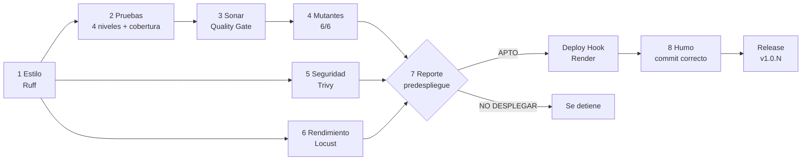

# TestQuiz – El Saboteador

[](https://github.com/DeividJulian/Trivia_Proyecto/actions/workflows/ci.yml)
[](https://github.com/DeividJulian/Trivia_Proyecto/releases)
[](https://sonarcloud.io/summary/new_code?id=DeividJulian_Trivia_Proyecto)
[](https://sonarcloud.io/summary/new_code?id=DeividJulian_Trivia_Proyecto)


> Trivia en vivo al estilo Kahoot con un **modo Saboteador**: desde un panel de administrador se
> activan errores a propósito (mutantes) y las pruebas los detectan antes de que lleguen a
> producción. Es el **efecto dominó** hecho visible.

**En vivo:** <https://testquiz-el-saboteador.onrender.com> · **API:** [`/docs`](https://testquiz-el-saboteador.onrender.com/docs)
(plan gratuito: la primera visita puede tardar cerca de un minuto en despertar el servicio).

Proyecto final de **Pruebas y Mantenimiento de Software**, Universidad Cooperativa de Colombia,
sede Pasto. Exposición: 9 de noviembre de 2026.

## La idea en una frase

El objetivo no es solo que el juego funcione, sino **tener evidencia, antes de desplegar, de que
funciona**: nada llega a Render si no pasa las compuertas automáticas del pipeline.

## Cómo se juega

| Vista | Qué hace |
|---|---|
| **Profesor** | Crea la partida, muestra el PIN, inicia y avanza las preguntas |
| **Jugador** | Se une con el PIN desde otra pestaña o el celular y responde; gana más quien acierta rápido y en racha |
| **Saboteador** | Activa mutantes, ejecuta las pruebas (tablero de dominó) y mira en vivo cuántos puntos falsos repartió el sabotaje |
| **Ventana de daño** | Para el proyector: ranking real vs. mostrado, daño por jugador y respuestas afectadas |

Guion de 3 minutos donde el sabotaje cambia al ganador: [docs/GUIA_DEMO.md](docs/GUIA_DEMO.md).

## El pipeline: 8 etapas antes de desplegar



Las etapas 7 y 8 solo corren en `main`. Render tiene `autoDeploy: false`: **solo despliega si el
reporte da APTO**, y el release se publica **después** de que el humo confirma que Render sirve el
commit recién probado.

## Compuertas (último reporte de `develop`, 2026-11-06)

| Compuerta | Resultado |
|---|---|
| Estilo (Ruff) | Sin hallazgos |
| Pruebas por nivel | 204 de componente · 51 de integración · 113 de sistema · 5 de aceptación |
| Suite completa | 376 pruebas, 0 fallidas (3 omitidas: humo, necesita la URL desplegada) |
| Cobertura | 98,11 % (mínimo 85 %) |
| Mutantes | 6 de 6 detectados |
| Trivy (repositorio, configuración e imagen) | 0 hallazgos HIGH/CRITICAL |
| SonarQube Cloud | Quality Gate PASSED |
| Rendimiento (50 usuarios) | p95 4 ms, 0 % de fallos (umbrales: < 500 ms y < 1 %) |
| Defectos | Ningún defecto Alto o Crítico abierto |

**Veredicto: APTO PARA DESPLEGAR.** Detalle en [docs/evidencias/REPORTE_PREDESPLIEGUE-develop.md](docs/evidencias/REPORTE_PREDESPLIEGUE-develop.md).

## Rendimiento y punto de quiebre

| Dónde corre | Degradación sostenida | Punto de quiebre | Fallos |
|---|---|---|---|
| uvicorn en Windows (desarrollo) | 250 usuarios | 600 usuarios | 0 % |
| Contenedor Alpine (la imagen que se despliega) | 500 usuarios | 800 usuarios | 0 % |
| **Render free (0,1 CPU, 512 MB)** | **90 usuarios** | **220 usuarios** | **0 %** |

Con 50 usuarios y WebSocket, Render free da un p95 de 420 ms y 0 % de fallos. El límite es la CPU
del plan, no el código. Detalle, gráficas y límites de cada medición en
[docs/RESULTADOS_RENDIMIENTO.md](docs/RESULTADOS_RENDIMIENTO.md).

## Ejecutar en local (CMD de Windows)

```cmd
python -m venv .venv
.venv\Scripts\activate
pip install -r requirements-dev.txt
set ADMIN_TOKEN=demo123
uvicorn app.main:app --port 8000 --timeout-keep-alive 75
```

- Juego: <http://127.0.0.1:8000/> (token del Saboteador en local: `demo123`)
- API: <http://127.0.0.1:8000/docs> · contratos y variables: [docs/API.md](docs/API.md)

| Para… | Comando |
|---|---|
| Revisar estilo | `ruff check .` y `ruff format --check .` |
| Correr todas las pruebas | `pytest -q` |
| Correr un nivel | `pytest -m componente` · `integracion` · `sistema` · `aceptacion` |
| Verificar los mutantes | `python scripts\verificar_mutantes.py` |
| Carga con Locust | `locust -f performance\locustfile.py --host http://127.0.0.1:8000 --headless -u 50 -r 10 -t 2m` |
| Imagen y Trivy | `docker build -t testquiz .` y `trivy image testquiz` |

## Documentación

| Tema | Documento |
|---|---|
| Plan, niveles y tipos de prueba (ISTQB) | [PLAN_DE_PRUEBAS.md](docs/PLAN_DE_PRUEBAS.md) · [PRINCIPIOS.md](docs/PRINCIPIOS.md) · [CICLO_DE_VIDA.md](docs/CICLO_DE_VIDA.md) |
| Historias de usuario y exploratorias | [HISTORIAS_USUARIO.md](docs/HISTORIAS_USUARIO.md) · [PRUEBAS_EXPLORATORIAS.md](docs/PRUEBAS_EXPLORATORIAS.md) |
| Defectos (DEF-001 a DEF-037) | [REPORTE_DEFECTOS.md](docs/REPORTE_DEFECTOS.md) |
| Mantenimiento y efecto dominó | [MANTENIMIENTO.md](docs/MANTENIMIENTO.md) · [SOLICITUD_CAMBIO_001.md](docs/SOLICITUD_CAMBIO_001.md) · [ANALISIS_IMPACTO.md](docs/ANALISIS_IMPACTO.md) |
| Métricas y análisis adicional | [METRICAS.md](docs/METRICAS.md) · [ANALISIS_ADICIONAL.md](docs/ANALISIS_ADICIONAL.md) |
| Bitácora de pruebas | [BITACORA_PRUEBAS.md](docs/BITACORA_PRUEBAS.md) |
| Despliegue | [GUIA_RENDER.md](docs/GUIA_RENDER.md) · [REGISTRO_DESPLIEGUES.md](docs/REGISTRO_DESPLIEGUES.md) |

## Equipo

| Integrante | Rol principal |
|---|---|
| Deivid Julián Alvarado | Desarrollo backend y automatización de pruebas |
| Juan Maya | Plan de pruebas, aceptación, impacto del sabotaje y corrección de calidad |
| Jack Limas | Rendimiento, seguridad, integración continua y despliegue |

Stack: Python 3.12 · FastAPI · Pydantic v2 · Uvicorn · WebSockets · pytest · Ruff · Locust · Trivy · SonarQube Cloud · Docker · GitHub Actions · Render.
