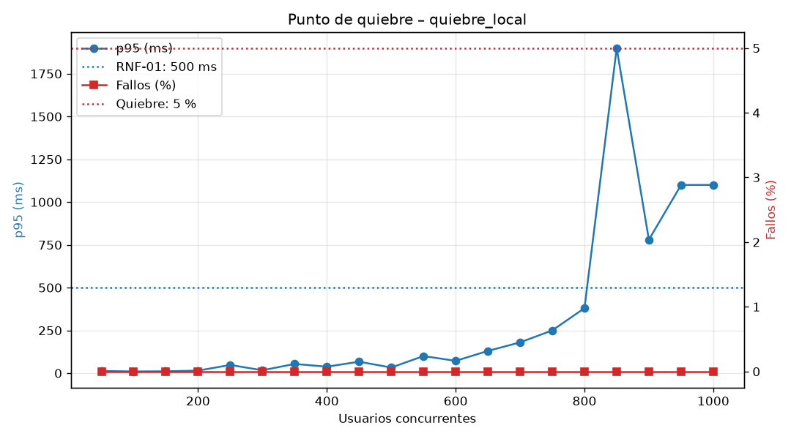

# Resultados de rendimiento

Pruebas no funcionales con Locust contra el servidor local (2026-11-04).

| Dato | Valor |
|---|---|
| Servidor | `uvicorn app.main:app --port 8000 --timeout-keep-alive 75`, **1 worker**, estado en memoria |
| Máquina | Laptop Windows 11 (Core i5); Locust y el servidor en la **misma** máquina |
| Host usado | `http://127.0.0.1:8000` (con `localhost`, Windows prueba IPv6 primero y suma ~2 s a cada conexión nueva del cliente; ver sesión exploratoria 3) |
| Usuarios | Presentadores (1 de cada ~21) que crean, inician y avanzan partidas + jugadores que se unen, consultan el estado y responden |

## Carga vs. estrés

| | Prueba de **carga** | Prueba de **estrés** (punto de quiebre) |
|---|---|---|
| Pregunta | ¿Cumple los RNF con la carga esperada (una clase de 50)? | ¿Hasta dónde aguanta y cómo falla? |
| Script | `performance/locustfile.py` | `performance/punto_quiebre.py` (escalones) |
| Carga | 50 usuarios fijos, 2 minutos | De 50 a 1000 usuarios, +50 cada 20 s |
| Criterio | RNF-01 p95 < 500 ms, RNF-02 fallos < 1 % | Quiebre: fallos > 5 % o p95 > 2000 ms |

## Carga: 50 usuarios, 2 minutos

```
locust -f performance\locustfile.py --host http://127.0.0.1:8000 --headless -u 50 -r 10 -t 2m --csv performance\resultados\carga_local
python performance\verificar_umbrales.py performance\resultados\carga_local_stats.csv
```

| Requisito | Medido | Umbral | Resultado |
|---|---|---|---|
| RNF-01 p95 | 7 ms | < 500 ms | **CUMPLE** |
| RNF-02 fallos | 0,00 % (0 de 5003) | < 1 % | **CUMPLE** |
| Mediana | 4 ms | — | — |
| Rendimiento | 42 peticiones/s | — | — |

## Estrés: punto de quiebre

```
set QUIEBRE_INICIO=50 && set QUIEBRE_INCREMENTO=50 && set QUIEBRE_SEGUNDOS_ESCALON=20 && set QUIEBRE_MAXIMO=1000
locust -f performance\punto_quiebre.py --host http://127.0.0.1:8000 --headless --csv performance\resultados\quiebre_local --csv-full-history
python performance\analizar_resultados.py quiebre_local
```



| Usuarios | p95 (ms) | Fallos (%) | Peticiones/s | Estado |
|---|---|---|---|---|
| 50 | 13 | 0,00 | 28 | OK |
| 200 | 15 | 0,00 | 153 | OK |
| 400 | 38 | 0,00 | 325 | OK |
| 600 | 72 | 0,00 | 491 | OK |
| 700 | 180 | 0,00 | 549 | OK |
| 750 | 250 | 0,00 | 580 | OK |
| 800 | 380 | 0,00 | 579 | OK |
| **850** | **1900** | 0,00 | 500 | **DEGRADADO** (incumple RNF-01) |
| 900 | 780 | 0,00 | 569 | DEGRADADO |
| 1000 | 1100 | 0,00 | 542 | DEGRADADO |

Tabla completa: `performance/resultados/quiebre_local_reporte.md` (p95 del escalón = el mayor p95
de sus ventanas, criterio conservador).

- **Punto de degradación: 850 usuarios** (p95 ≥ 500 ms).
- **Punto de quiebre: no se alcanzó hasta 1000 usuarios** (0 % de fallos, p95 máximo 1900 ms).
- **Saturación:** desde ~700 usuarios el rendimiento deja de crecer (~550–580 peticiones/s) y lo
  que crece es la latencia: el sistema hace cola en lugar de fallar.

### Límite de la medición (importante)

Desde unos **600 usuarios Locust avisó "CPU usage above 90 %"**: el generador de carga y el
servidor compiten por la misma CPU. Por encima de ese punto, parte de la latencia medida es del
propio Locust, y los valores de 850–1000 usuarios **no** son fiables como límite del servidor.
En Windows Locust no puede repartir la carga en varios procesos (`--processes` necesita `fork`).
Por eso el punto de quiebre se repite **contra Render** (cierre del proyecto), con el generador en
otra máquina.

## Defectos encontrados por estas pruebas

| DEF | Hallazgo | Tipo |
|---|---|---|
| DEF-014 | Conexiones reiniciadas tras 5 s de inactividad (keep-alive de uvicorn) | Servidor (configuración) |
| DEF-015 | El script avanzaba partidas que no se iniciaron: 409 falsos | Script de prueba |
| DEF-016 | El script agotaba el cupo de 500 partidas con partidas vacías: quiebre falso en 800 usuarios | Script de prueba |

La primera corrida "quebró" en 800 usuarios, pero por DEF-016 y no por rendimiento. Sin corregir
el script, el reporte habría sido falso: **las herramientas de prueba también tienen defectos**.

## Cuello de botella y mejora propuesta

| Cuello de botella | Por qué | Mejora (mantenimiento perfectivo) |
|---|---|---|
| **1 worker de uvicorn** | Un solo proceso de Python usa un solo núcleo: el techo es ~580 peticiones/s | Varios workers o varias instancias |
| **Estado en memoria** | `GestorPartidas` vive en el proceso: con 2 workers cada uno tendría partidas distintas. Por eso hoy no se puede escalar | Guardar partidas y difusión en **Redis** (estado + pub/sub de WebSocket) y correr varias instancias detrás de un balanceador |
| Cupo global de partidas | Partidas vacías en LOBBY ocupan cupo 30 min (DEF-016) | Limpiar antes las partidas sin jugadores; límite por cliente |

Conclusión: con la carga esperada (una clase de 50) el servidor tiene un margen de más de 15
veces: degrada cerca de 850 usuarios en un portátil y no quiebra hasta 1000. Para más concurrencia
el siguiente paso es Redis + varias instancias.
