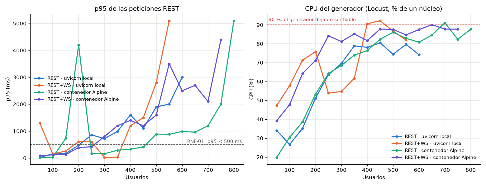
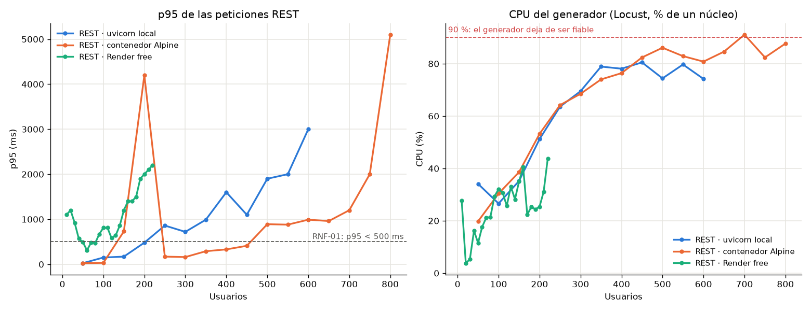

# Resultados de rendimiento

Pruebas no funcionales con Locust.

> Este documento tiene **dos mediciones en máquinas distintas** y no se comparan entre sí:
> - **2026-11-04, portátil de Deivid** (secciones siguientes): solo REST, uvicorn local.
> - **2026-11-06, portátil de Jack** (al final, "Rendimiento con WebSocket"): REST contra
>   REST + WebSocket, con uvicorn local y con el contenedor Alpine.

## Medición del 2026-11-04 (portátil de Deivid)

| Dato | Valor |
|---|---|
| Servidor | `uvicorn app.main:app --port 8000 --timeout-keep-alive 75`, **1 worker**, estado en memoria |
| Máquina | Laptop Windows 11 (Core i5); Locust y el servidor en la **misma** máquina |
| Host usado | `http://127.0.0.1:8000` (con `localhost`, Windows prueba IPv6 primero y suma ~2 s a cada conexión nueva del cliente; ver sesión exploratoria 3) |
| Usuarios | Presentadores (1 de cada ~21) que crean, inician y avanzan partidas + jugadores que se unen, consultan el estado y responden |

## Carga vs. estrés

| | Prueba de **carga** | Prueba de **estrés** (punto de quiebre) |
|---|---|---|
| Pregunta | ¿Cumple los RNF con la carga esperada (una clase de 50)? | ¿Hasta dónde aguanta y cómo falla? |
| Script | `performance/locustfile.py` | `performance/punto_quiebre.py` (escalones) |
| Carga | 50 usuarios fijos, 2 minutos | De 50 a 1000 usuarios, +50 cada 20 s |
| Criterio | RNF-01 p95 < 500 ms, RNF-02 fallos < 1 % | Quiebre: fallos > 5 % o p95 > 2000 ms |

## Carga: 50 usuarios, 2 minutos

```
locust -f performance\locustfile.py --host http://127.0.0.1:8000 --headless -u 50 -r 10 -t 2m --csv performance\resultados\carga_local
python performance\verificar_umbrales.py performance\resultados\carga_local_stats.csv
```

| Requisito | Medido | Umbral | Resultado |
|---|---|---|---|
| RNF-01 p95 | 7 ms | < 500 ms | **CUMPLE** |
| RNF-02 fallos | 0,00 % (0 de 5003) | < 1 % | **CUMPLE** |
| Mediana | 4 ms | — | — |
| Rendimiento | 42 peticiones/s | — | — |

## Estrés: punto de quiebre

```
set QUIEBRE_INICIO=50 && set QUIEBRE_INCREMENTO=50 && set QUIEBRE_SEGUNDOS_ESCALON=20 && set QUIEBRE_MAXIMO=1000
locust -f performance\punto_quiebre.py --host http://127.0.0.1:8000 --headless --csv performance\resultados\quiebre_local --csv-full-history
python performance\analizar_resultados.py quiebre_local
```


| Usuarios | p95 (ms) | Fallos (%) | Peticiones/s | Estado |
|---|---|---|---|---|
| 50 | 13 | 0,00 | 28 | OK |
| 200 | 15 | 0,00 | 153 | OK |
| 400 | 38 | 0,00 | 325 | OK |
| 600 | 72 | 0,00 | 491 | OK |
| 700 | 180 | 0,00 | 549 | OK |
| 750 | 250 | 0,00 | 580 | OK |
| 800 | 380 | 0,00 | 579 | OK |
| **850** | **1900** | 0,00 | 500 | **DEGRADADO** (incumple RNF-01) |
| 900 | 780 | 0,00 | 569 | DEGRADADO |
| 1000 | 1100 | 0,00 | 542 | DEGRADADO |

Tabla completa: `performance/resultados/quiebre_local_reporte.md` (p95 del escalón = el mayor p95
de sus ventanas, criterio conservador).

- **Punto de degradación: 850 usuarios** (p95 ≥ 500 ms).
- **Punto de quiebre: no se alcanzó hasta 1000 usuarios** (0 % de fallos, p95 máximo 1900 ms).
- **Saturación:** desde ~700 usuarios el rendimiento deja de crecer (~550–580 peticiones/s) y lo
  que crece es la latencia: el sistema hace cola en lugar de fallar.

### Límite de la medición (importante)

Desde unos **600 usuarios Locust avisó "CPU usage above 90 %"**: el generador de carga y el
servidor compiten por la misma CPU. Por encima de ese punto, parte de la latencia medida es del
propio Locust, y los valores de 850–1000 usuarios **no** son fiables como límite del servidor.
En Windows Locust no puede repartir la carga en varios procesos (`--processes` necesita `fork`).
Por eso el punto de quiebre se repite **contra Render** (cierre del proyecto), con el generador en
otra máquina.

## Defectos encontrados por estas pruebas

| DEF | Hallazgo | Tipo |
|---|---|---|
| DEF-014 | Conexiones reiniciadas tras 5 s de inactividad (keep-alive de uvicorn) | Servidor (configuración) |
| DEF-015 | El script avanzaba partidas que no se iniciaron: 409 falsos | Script de prueba |
| DEF-016 | El script agotaba el cupo de 500 partidas con partidas vacías: quiebre falso en 800 usuarios | Script de prueba |

La primera corrida "quebró" en 800 usuarios, pero por DEF-016 y no por rendimiento. Sin corregir
el script, el reporte habría sido falso: **las herramientas de prueba también tienen defectos**.

## Cuello de botella y mejora propuesta

| Cuello de botella | Por qué | Mejora (mantenimiento perfectivo) |
|---|---|---|
| **1 worker de uvicorn** | Un solo proceso de Python usa un solo núcleo: el techo es ~580 peticiones/s | Varios workers o varias instancias |
| **Estado en memoria** | `GestorPartidas` vive en el proceso: con 2 workers cada uno tendría partidas distintas. Por eso hoy no se puede escalar | Guardar partidas y difusión en **Redis** (estado + pub/sub de WebSocket) y correr varias instancias detrás de un balanceador |
| Cupo global de partidas | Partidas vacías en LOBBY ocupan cupo 30 min (DEF-016) | Limpiar antes las partidas sin jugadores; límite por cliente |

Conclusión: con la carga esperada (una clase de 50) el servidor tiene un margen de más de 15
veces: degrada cerca de 850 usuarios en un portátil y no quiebra hasta 1000. Para más concurrencia
el siguiente paso es Redis + varias instancias.

## Rendimiento con WebSocket (2026-11-06, portátil de Jack)

En el juego, cada acción (unirse, iniciar, siguiente, responder) se **difunde por WebSocket** a todos
los jugadores de la partida. La prueba anterior solo usaba REST; esta mide además ese costo.

### Qué representa cada medición

| Medición | Qué es | Qué representa |
|---|---|---|
| **uvicorn local** | `uvicorn app.main:app` en el venv de **Windows**, 1 worker | El entorno de desarrollo. **No** es lo que se despliega: en Windows uvicorn no tiene `uvloop` y usa el bucle estándar de asyncio |
| **contenedor Alpine** | La imagen del `Dockerfile` (`testquiz:carga`) en Docker Desktop (WSL2), puerto reenviado a `127.0.0.1:8000` | **Lo que se despliega** en Render (misma imagen, con `uvloop` y `httptools`), pero en este portátil y pasando por el reenvío de puertos de Docker Desktop |
| **REST** | `performance/locustfile.py` (sin cambios) | Presentadores y jugadores que solo usan la API |
| **REST + WS** | `performance/locustfile_ws.py` | Los mismos usuarios, pero cada jugador mantiene `/ws/{pin}` abierto, como el front real |

Ninguna de las dos es Render: el punto de quiebre contra Render queda para el cierre del proyecto.

### Cómo se midió

| Dato | Valor |
|---|---|
| Máquina | Intel Core i5-12450H (8 núcleos, 12 hilos), 7,7 GB de RAM, Windows 11; Docker Desktop 4.98 con WSL2 (12 CPU, 3,9 GB) |
| Generador | Locust 2.47.0 en la **misma** máquina (un solo proceso, un núcleo) |
| Otros contenedores | Los 19 contenedores de otros proyectos, **pausados** durante las mediciones (`docker pause`) y reanudados al terminar |
| Condición de memoria | **Entre 0,5 y 1,0 GB de RAM libre** en todas las corridas (medido al inicio y al final de cada una). Es la principal fuente de ruido |
| CPU | `performance/monitor_cpu.py` cada 2 s: CPU de Locust y del servidor (uvicorn o `docker stats`), en % de un núcleo |
| WebSocket | Métricas propias en `<prefijo>_ws_eventos.csv` (no se mezclan con el p95 de REST de Locust) |
| Carga | 50 usuarios, 10 por segundo, 2 minutos |
| Estrés | Escalones de 50 a 1000 usuarios, +50 cada 20 s (mismos parámetros que la medición anterior) |
| Análisis | `python performance\comparar_escenarios.py quiebre ...` y `... carga ...` → `performance/resultados/comparacion_*.md` y `.png` |

**Latencia de difusión:** tiempo desde que un jugador envía `POST /respuestas` hasta el primer mensaje
de estado que recibe por WebSocket después. Solo cuenta si el POST respondió 200: con 409 el servidor
no difunde nada. Ese sesgo se detectó en una corrida de prueba (p95 de 600 ms en un servidor sin
carga) y se corrigió antes de medir.

### Carga: 50 usuarios, 2 minutos

| Escenario | Peticiones REST | p95 REST (ms) | Mediana (ms) | Fallos (%) | Peticiones/s | CPU Locust máx. (%) | CPU servidor máx. (%) | WS conexiones (fallidas) | WS mensajes (por s) | Difusión p50 / p95 (ms) |
|---|---|---|---|---|---|---|---|---|---|---|
| REST · uvicorn local | 4914 | 56 | 6 | 0,00 | 41,3 | 38 | 20 | — | — | — |
| REST + WS · uvicorn local | 5015 | 38 | 6 | 0,00 | 42,1 | 43 | 24 | 48 (0) | 17 081 (257) | 14 / 36 |
| REST · contenedor Alpine | 4978 | 14 | 6 | 0,00 | 41,9 | 37 | 56 | — | — | — |
| REST + WS · contenedor Alpine | 4701 | 79 | 9 | 0,00 | 39,6 | 48 | 59 | 48 (0) | 18 896 (266) | 22 / 624 |

- **RNF-01 (p95 < 500 ms) y RNF-02 (fallos < 1 %) se cumplen en los cuatro escenarios.**
- Con 50 usuarios el servidor envía **unos 260 mensajes de WebSocket por segundo**: cada acción se
  difunde a todos los jugadores de la partida. REST sigue en unas 42 peticiones por segundo.
- En el contenedor, abrir los WebSockets sube el p95 de REST de 14 a 79 ms, y la difusión tiene un p95
  de 624 ms. En local la diferencia entre REST y REST + WS queda dentro del ruido (56 y 38 ms).

### Estrés: punto de quiebre



| Escenario | Degradación sostenida (p95 ≥ 500 ms) | Punto de quiebre (p95 > 2000 ms o fallos > 5 %) | Fallos | Locust saturado (≥ 90 %) desde | Datos fiables hasta |
|---|---|---|---|---|---|
| REST · uvicorn local | 250 usuarios | **600 usuarios** | 0 % | nunca (máx. 80 %) | 600 usuarios |
| REST + WS · uvicorn local | 400 usuarios (picos aislados desde 50) | **550 usuarios** | 0 % | 400 usuarios | **350 usuarios** |
| REST · contenedor Alpine | 500 usuarios (picos aislados en 150 y 200) | **800 usuarios** | 0 % | 700 usuarios | 650 usuarios |
| REST + WS · contenedor Alpine | 300 usuarios | **750 usuarios** | 0 % | 650 usuarios | 600 usuarios |

Tablas completas por escalón (p95, fallos, peticiones/s, CPU de Locust y del servidor, mensajes de
WebSocket por segundo y p95 de difusión): `performance/resultados/comparacion_quiebre.md`.
El punto de quiebre es el escalón donde `punto_quiebre.py` detuvo la prueba. En las tablas y la gráfica,
el p95 de cada escalón es el mayor de su ventana (criterio conservador); por eso aparecen picos aislados.

### Qué muestran los datos

1. **Lo que se despliega aguanta más que el entorno de desarrollo.** El contenedor quebró en 800
   usuarios (REST) frente a 600 de uvicorn en Windows. Explicación probable, no demostrada: en Linux
   uvicorn usa `uvloop` (verificado dentro de la imagen) y en Windows no está disponible.
2. **WebSocket adelanta la degradación.** En el contenedor, la degradación sostenida pasa de 500 a
   **300 usuarios** y el quiebre de 800 a 750. Con 400 usuarios la difusión ya tarda más de 1 s (p95).
3. **Nunca hubo fallos.** En todos los casos el servidor hace cola (sube la latencia) en lugar de
   rechazar peticiones. Los 524 y 712 WebSockets abiertos en las pruebas de estrés no tuvieron
   conexiones fallidas ni cierres inesperados.
4. **Para la clase (50 usuarios) hay margen:** en el peor caso del contenedor la degradación empieza
   en 300 usuarios, seis veces la carga esperada.

### Límites de la medición (importante)

- **CPU del generador.** Desde que Locust se satura (columna "Locust saturado desde"), parte de la
  latencia la pone el generador. El caso más afectado es REST + WS local: sus datos solo son fiables
  hasta 350 usuarios, así que su quiebre en 550 es orientativo.
- **Memoria.** Con 0,5 a 1 GB libres hubo picos aislados (p95 de 1300 ms con 50 usuarios en REST + WS
  local; 4200 ms con 200 en REST contenedor) que no se repiten en el escalón siguiente. Por eso se
  habla de degradación **sostenida**.
- **Generador y servidor en la misma máquina**, y en el contenedor el tráfico pasa por el reenvío de
  puertos de Docker Desktop. Una medición más limpia es contra Render, con el generador en otra máquina.
- **Incidente descartado.** La primera corrida de carga REST + WS contra el contenedor (14:28) quedó
  congelada 41 minutos: Docker Desktop dejó de responder (incluso `docker stats`). Se descartó.
  Una reproducción controlada con 30 WebSockets, contra el contenedor y contra uvicorn, no lo repitió,
  y la segunda corrida (15:22) terminó normal: se atribuye al entorno, no a la aplicación. El monitor
  de CPU se quedó colgado esperando a Docker (**DEF-036**, corregido con un tiempo límite), y a cada
  corrida se le agregó un vigilante: si se pasa del tiempo previsto, se detiene y queda inválida.
- Esta sección **no** se compara con la del 2026-11-04 (otra máquina, solo REST, uvicorn local), donde
  la degradación empezó en 850 usuarios y no hubo quiebre hasta 1000.

## Punto de quiebre contra Render (2026-11-06, portátil de Jack)

Medición contra el servicio **desplegado**: `https://testquiz-el-saboteador.onrender.com`, plan
**free**, commit `70dc913` (el de `main`, release v1.0.200). Antes de medir se despertó el servicio
y se comprobó que `/salud` respondía ese commit.

### Qué cambia respecto a local y contenedor

| | uvicorn local / contenedor | Render free |
|---|---|---|
| CPU del servidor | Los núcleos del portátil (12 hilos) | **0,1 CPU** (una décima de núcleo) |
| Memoria | La del portátil / 3,9 GB de WSL2 | **512 MB** |
| Red | `127.0.0.1` (< 1 ms) | Internet + TLS: **139 ms** la petición más rápida de toda la prueba |
| Generador | Misma máquina que el servidor | Otra máquina (este portátil): el servidor no compite con Locust por la CPU |

### Cómo se midió

| Dato | Valor |
|---|---|
| Comando | `set QUIEBRE_INICIO=10 && set QUIEBRE_INCREMENTO=10 && set QUIEBRE_SEGUNDOS_ESCALON=20` y `locust -f performance\punto_quiebre.py --host https://testquiz-el-saboteador.onrender.com --headless --csv performance\resultados\quiebre_render --csv-full-history` |
| Análisis | `python performance\analizar_resultados.py quiebre_render` → [reporte](../performance/resultados/quiebre_render_reporte.md) y [gráfica](../performance/resultados/quiebre_render_grafica.png) |
| CPU del generador | `performance\monitor_cpu.py` cada 2 s. La CPU del servidor de Render no se puede medir desde aquí |
| Parada | `punto_quiebre.py` detuvo la prueba en el primer escalón que superó el quiebre: no se siguió golpeando el servicio |
| REST + WebSocket | Una sola corrida corta: 50 usuarios, 90 s (`locustfile_ws.py`) |

### Resultado: REST, escalones de 10 usuarios



| Escenario | Degradación sostenida (p95 ≥ 500 ms) | Punto de quiebre | Máximo de peticiones/s | Fallos | Locust saturado |
|---|---|---|---|---|---|
| REST · uvicorn local | 250 usuarios | 600 usuarios | 273 | 0 % | nunca |
| REST · contenedor Alpine | 500 usuarios | 800 usuarios | 384 | 0 % | desde 700 |
| **REST · Render free** | **90 usuarios** | **220 usuarios** (p95 2200 ms) | **90** | **0 %** | **nunca (máx. 44 % por escalón)** |

- Por escalón (tabla completa en `performance/resultados/comparacion_quiebre_render.md`): de 50 a 80
  usuarios el p95 está entre 310 y 490 ms (cumple RNF-01); desde 90 usuarios ya no baja de 500 ms.
  `punto_quiebre.py` paró en 220 usuarios; con el criterio conservador de las tablas (el mayor p95 de
  la ventana), el escalón de 210 ya marca 2100 ms.
- **Techo de ~87 peticiones por segundo.** Desde 140 usuarios, añadir usuarios ya no aumenta las
  peticiones atendidas (87–90 por segundo): solo crece la cola y con ella el p95. Es el límite de la
  décima de CPU.
- **El límite es de Render, no del generador.** Locust nunca pasó del 44 % de su núcleo por escalón
  ni registró avisos de CPU, y Render respondía menos peticiones que el contenedor con la misma carga.
- **Con 10–30 usuarios el p95 sale alto (900–1200 ms)** aunque la mediana es de 210–340 ms: en esos
  escalones hay pocas peticiones (unas 6 por segundo), así que unas pocas lentas (conexiones TLS nuevas
  al entrar usuarios) dominan el p95. Por eso `analizar_resultados.py` marca "degradado" desde 10;
  la degradación **sostenida** empieza en 90.

### Resultado: REST + WebSocket, 50 usuarios, 90 s

| Escenario | Peticiones REST | p95 REST (ms) | Mediana (ms) | Fallos | WS conexiones (fallidas) | WS mensajes (por s) | Difusión p50 / p95 (ms) |
|---|---|---|---|---|---|---|---|
| REST + WS · Render free | 3069 | 420 | 210 | 0 % | 48 (0) | 17 311 (240) | 90 / 252 |

**Con la carga de una clase (50 usuarios con su WebSocket abierto) Render free cumple RNF-01 y
RNF-02**: p95 de 420 ms y 0 % de fallos, aunque con menos margen que en local (38 ms) por la red y
la décima de CPU. La CPU del generador de esta corrida no es válida (**DEF-037**: el monitor midió
una consola en lugar de Locust); Locust no registró avisos de CPU.

### El servicio después de la prueba

- `/salud` respondió `{"estado":"ok","version":"1.0.0","commit":"70dc913…"}` al terminar cada corrida
  (18:37 y 18:47).
- **No hubo reinicio:** una partida centinela creada después del quiebre seguía en `LOBBY` al final, y
  en el quiebre no hubo ningún fallo (un reinicio borra las partidas en memoria y habría dado 404).

### Conclusiones

1. **Para la exposición, Render free alcanza:** con 50 usuarios cumple los requisitos, incluido el
   WebSocket. El margen real es de unos **80 usuarios** con p95 < 500 ms.
2. **El cuello de botella es la CPU del plan, no el código:** la misma imagen aguantó 800 usuarios en
   el contenedor del portátil. Mejora propuesta: un plan con más CPU o varias instancias (lo que exige
   estado compartido, ver "Cuello de botella y mejora propuesta").
3. **La red suma al menos 139 ms** a cada petición: por eso el p95 en Render nunca baja de 240 ms,
   aunque el servidor esté libre.
4. Igual que en local, **0 % de fallos**: el servidor hace cola y no rechaza peticiones.
