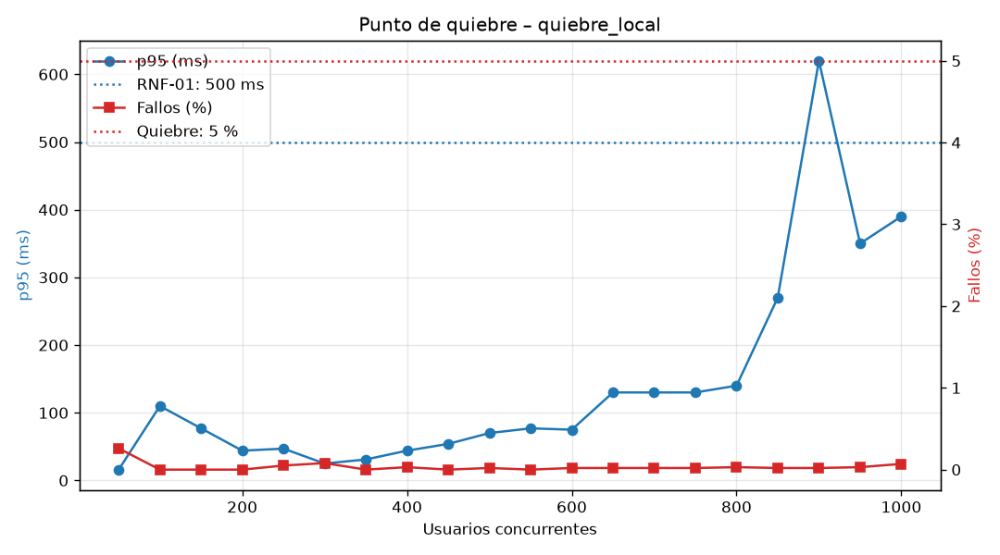

# Resultados de rendimiento – quiebre_local

| Usuarios | Peticiones | p95 (ms) | Fallos (%) | Peticiones/s | Estado |
|---|---|---|---|---|---|
| 50 | 761 | 16 | 0.26 | 28.3 | OK |
| 100 | 1668 | 110 | 0.00 | 65.9 | OK |
| 150 | 2563 | 77 | 0.00 | 112.3 | OK |
| 200 | 3337 | 44 | 0.00 | 153.7 | OK |
| 250 | 4270 | 47 | 0.05 | 194.5 | OK |
| 300 | 4968 | 25 | 0.08 | 237.1 | OK |
| 350 | 5741 | 31 | 0.00 | 269.8 | OK |
| 400 | 6451 | 44 | 0.03 | 309.3 | OK |
| 450 | 7398 | 54 | 0.00 | 351.7 | OK |
| 500 | 8117 | 70 | 0.02 | 387.1 | OK |
| 550 | 9015 | 77 | 0.00 | 432.0 | OK |
| 600 | 9611 | 75 | 0.02 | 466.2 | OK |
| 650 | 9893 | 130 | 0.02 | 498.3 | OK |
| 700 | 10958 | 130 | 0.02 | 528.3 | OK |
| 750 | 11438 | 130 | 0.02 | 577.1 | OK |
| 800 | 12759 | 140 | 0.03 | 614.5 | OK |
| 850 | 12608 | 270 | 0.02 | 639.9 | OK |
| 900 | 12624 | 620 | 0.02 | 621.5 | DEGRADADO |
| 950 | 14614 | 350 | 0.03 | 690.8 | OK |
| 1000 | 14567 | 390 | 0.07 | 715.2 | OK |

- **Punto de degradación** (incumple RNF-01 o RNF-02): 900 usuarios
- **Punto de quiebre** (> 5 % de fallos o p95 > 2000 ms): no se alcanzó hasta 1000 usuarios
