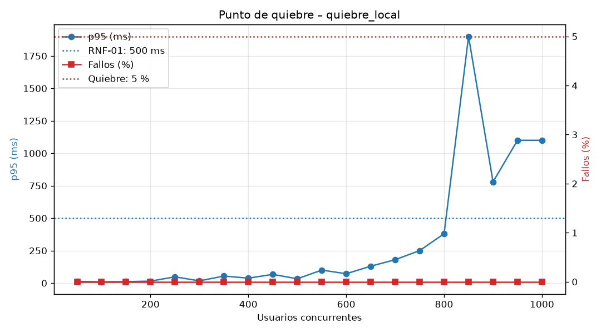

# Resultados de rendimiento – quiebre_local

| Usuarios | Peticiones | p95 (ms) | Fallos (%) | Peticiones/s | Estado |
|---|---|---|---|---|---|
| 50 | 779 | 13 | 0.00 | 28.0 | OK |
| 100 | 1689 | 10 | 0.00 | 68.8 | OK |
| 150 | 2543 | 11 | 0.00 | 110.2 | OK |
| 200 | 3325 | 15 | 0.00 | 152.6 | OK |
| 250 | 4262 | 48 | 0.00 | 196.7 | OK |
| 300 | 5072 | 17 | 0.00 | 238.2 | OK |
| 350 | 5953 | 54 | 0.00 | 277.0 | OK |
| 400 | 6787 | 38 | 0.00 | 325.1 | OK |
| 450 | 7784 | 67 | 0.00 | 371.9 | OK |
| 500 | 8532 | 33 | 0.00 | 406.3 | OK |
| 550 | 9350 | 100 | 0.00 | 451.2 | OK |
| 600 | 10134 | 72 | 0.00 | 490.5 | OK |
| 650 | 10394 | 130 | 0.00 | 521.4 | OK |
| 700 | 11555 | 180 | 0.00 | 548.5 | OK |
| 750 | 11513 | 250 | 0.00 | 580.0 | OK |
| 800 | 11795 | 380 | 0.00 | 579.1 | OK |
| 850 | 9151 | 1900 | 0.00 | 500.2 | DEGRADADO |
| 900 | 11213 | 780 | 0.00 | 569.1 | DEGRADADO |
| 950 | 11425 | 1100 | 0.00 | 541.4 | DEGRADADO |
| 1000 | 11197 | 1100 | 0.00 | 541.9 | DEGRADADO |

- **Punto de degradación** (incumple RNF-01 o RNF-02): 850 usuarios
- **Punto de quiebre** (> 5 % de fallos o p95 > 2000 ms): no se alcanzó hasta 1000 usuarios
