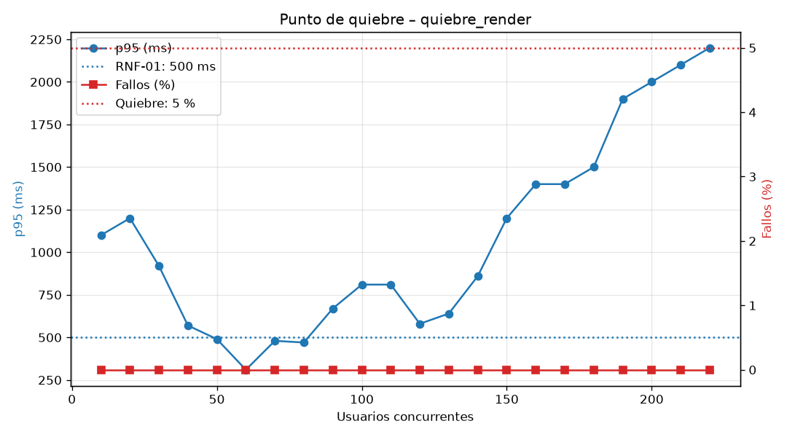

# Resultados de rendimiento – quiebre_render

| Usuarios | Peticiones | p95 (ms) | Fallos (%) | Peticiones/s | Estado |
|---|---|---|---|---|---|
| 10 | 130 | 1100 | 0.00 | 4.8 | DEGRADADO |
| 20 | 123 | 1200 | 0.00 | 6.1 | DEGRADADO |
| 30 | 127 | 920 | 0.00 | 6.4 | DEGRADADO |
| 40 | 558 | 570 | 0.00 | 19.3 | DEGRADADO |
| 50 | 550 | 490 | 0.00 | 28.9 | OK |
| 60 | 868 | 310 | 0.00 | 37.4 | OK |
| 70 | 954 | 480 | 0.00 | 45.7 | OK |
| 80 | 1107 | 470 | 0.00 | 54.8 | OK |
| 90 | 1210 | 670 | 0.00 | 57.4 | DEGRADADO |
| 100 | 1385 | 810 | 0.00 | 65.2 | DEGRADADO |
| 110 | 1548 | 810 | 0.00 | 72.9 | DEGRADADO |
| 120 | 1693 | 580 | 0.00 | 81.7 | DEGRADADO |
| 130 | 1689 | 640 | 0.00 | 82.7 | DEGRADADO |
| 140 | 1603 | 860 | 0.00 | 86.8 | DEGRADADO |
| 150 | 1787 | 1200 | 0.00 | 88.9 | DEGRADADO |
| 160 | 1831 | 1400 | 0.00 | 89.6 | DEGRADADO |
| 170 | 1654 | 1400 | 0.00 | 83.7 | DEGRADADO |
| 180 | 1732 | 1500 | 0.00 | 84.8 | DEGRADADO |
| 190 | 1696 | 1900 | 0.00 | 86.1 | DEGRADADO |
| 200 | 1715 | 2000 | 0.00 | 87.2 | DEGRADADO |
| 210 | 1815 | 2100 | 0.00 | 88.7 | QUIEBRE |
| 220 | 1882 | 2200 | 0.00 | 86.8 | QUIEBRE |

- **Punto de degradación** (incumple RNF-01 o RNF-02): 10 usuarios
- **Punto de quiebre** (> 5 % de fallos o p95 > 2000 ms): 210 usuarios
